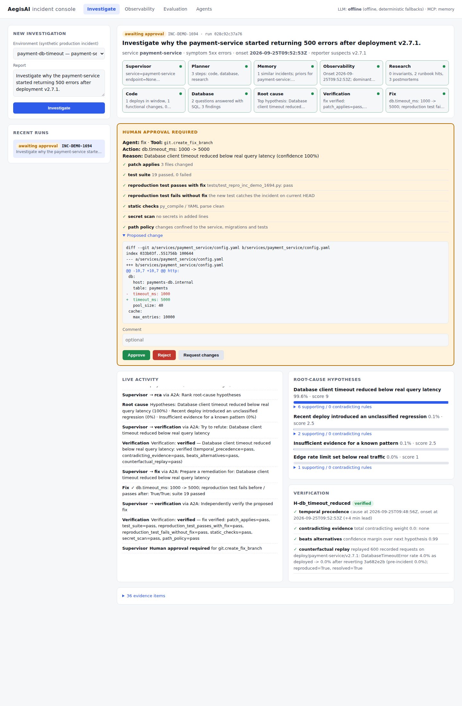

# AegisAI — multi-agent incident investigation

AegisAI takes a one-line incident report, such as *"payment-service started returning 500 errors
after deployment v2.7.1"*, and hands it to a team of specialist agents. They work out when the
failure started, which change caused it, and why. They then **prove** the cause by replaying
recorded production traffic with that change removed, prepare a tested fix in a sandbox, and
**wait for a human to approve** before anything is changed.

```
Supervisor ─► Planner ─► ⟨Observability ∥ Research⟩ ─► ⟨Code ∥ Database ∥ Research⟩ ─► RCA
     ▲                                                                                 │
     │            re-plan (inconclusive) ◄── Verification ◄─────────────────────────────┘
     │            reflect (refuted)      ◄──┘      │ verified
     └── Report ◄── Apply ◄── Human approval ◄── Verify fix ◄── Fix (sandbox)
```

It runs out of the box with no API keys. Every LLM step has a deterministic fallback. If
`ANTHROPIC_API_KEY` is set, it uses Claude, routing each task to a fast or a strong model.



## What it demonstrates

| Concept | Where |
|---|---|
| Multi-agent system: 10 roles (supervisor, planner and 8 specialists) | `aegis/agents/` |
| Stateful orchestration: parallel fan-out, conditional routing, loops | `aegis/orchestration/graph.py` (LangGraph `Send`, conditional edges) |
| Dynamic planning and re-planning | `aegis/agents/planner.py`: wave 2 is planned from wave-1 evidence, and a replan adds discriminating queries |
| Reflection / self-correction | Verification refutes, the hypothesis is rejected and RCA re-ranks (`reflect` node) |
| Human-in-the-loop | LangGraph `interrupt()` plus single-use HMAC approval tokens (`security/permissions.py`) |
| Durable execution | SQLite checkpointer; approvals survive restarts (`tests/test_graph.py::test_durable_resume_after_restart`) |
| MCP tool servers | 5 FastMCP servers (git, observability, database, docs, ops); in-memory or stdio transport (`aegis/mcp_servers/`, `aegis/tools/gateway.py`) |
| A2A agent interoperability | Agent Cards, JSON-RPC `message/send` / `tasks/get`; agents run in-process or as remote HTTP services (`aegis/a2a/`) |
| Hybrid RAG | BM25 + dense embeddings, RRF fusion, metadata filters and a reranker (`aegis/rag/retrieval.py`) |
| Agentic text-to-SQL | schema discovery, generation, validation, read-only execution, retry (`aegis/agents/database.py`) |
| Memory | short-term = graph state, episodic = past incidents, semantic = failure-pattern catalogue (`aegis/memory/`) |
| Evidence-based confidence | weighted rules plus a softmax with an explicit "insufficient evidence" hypothesis, not an LLM-asserted number (`aegis/agents/rca.py`) |
| Guardrails | per-agent tool allow-lists, prompt-injection quarantine, PII/secret masking, SQL guard, sandboxing (`aegis/security/`, `aegis/sandbox/`) |
| Model routing and cost accounting | complexity-aware fast/strong routing; routed vs all-strong cost logged per call (`aegis/llm/router.py`) |
| Structured outputs | Pydantic models everywhere; Claude via forced tool use; validation errors are fed back for one retry |
| Observability | spans per agent/tool/LLM call, live SSE events, Prometheus `/metrics`, OpenTelemetry when installed |
| Evaluation | 100-incident benchmark with baselines, ablations, calibration, grounding, SQL and retrieval metrics (`aegis/evaluation/`) |

## Quick start

```bash
pip install -e ".[dev]"

aegis demo                               # investigate the headline incident in the terminal
aegis demo --scenario checkout-flag      # other scenarios: aegis scenarios
aegis serve                              # dashboard at http://127.0.0.1:8000
pytest -q                                # 56 tests
aegis benchmark --n 100                  # about 1 hour on a laptop; writes evaluation/results/
```

Optional settings (see `.env.example`):

```bash
export ANTHROPIC_API_KEY=...                  # use Claude instead of the offline fallbacks
export AEGIS_MCP_TRANSPORT=stdio              # run MCP servers as subprocesses
aegis serve-agent observability --port 9101   # run one agent as a separate A2A service
export AEGIS_REMOTE_AGENTS=observability=http://127.0.0.1:9101
docker compose up --build                     # API + remote observability agent in two containers
```

Each MCP server also runs on its own (for example from Claude Desktop):
`aegis mcp git --workspace <path>`.

## The environment it investigates

There is no real production system to break, so `aegis/world/` builds one. Each incident gets:

* a **git monorepo** with 6 services, back-dated commits and `deploy/<service>/v<version>` tags;
* **24 hours of logs, metrics and traces**, produced by replaying synthetic traffic through the
  repo's own `platform_sim` engine against whichever revision was deployed at each minute (so
  stack traces carry real line numbers and error messages carry the real config values);
* a **production read replica**: deployments, feature-flag audit, dependency status, certificates,
  query stats, pool stats, and customer PII that must be masked;
* a **documentation corpus**: architecture invariants, runbooks, policies and postmortems.

There are 10 failure families: timeout reduced, pool shrunk, handler KeyError, rate limit,
unbounded cache (OOM), dropped index, upstream outage, feature flag, expired certificate and retry
storm. Each incident adds noise: red-herring deploys, deploys after the onset, culprits bundled
with harmless commits, decoy config changes, lost logs, missing or stale docs, prompt injections
in commits, docs and logs, and reporters who blame the wrong version.

## Benchmark results

Measured with `aegis benchmark --n 100` (seed 2026, offline mode). There are 100 generated incidents, 10 per failure family, with 34 decoy config changes, 27 prompt injections, 13 lost-log cases and 33 reporters blaming the wrong version.

| System | Failure-pattern accuracy | Culprit accuracy* |
|---|---|---|
| **AegisAI (full)** | **97%** | **100%** |
| Baseline: roll back the last deploy | – | 49% |
| Baseline: logs-only single agent | 87% | – |

\* The culprit is the exact commit, flag, dependency or certificate behind the incident. A rollback of the deploy that contains the culprit commit also counts.

* **97%** end-to-end success: correct root cause, and a verified fix applied after approval.
* **100%** of fixes passed independent verification whenever the root cause was right: the reproduction test fails before the fix and passes after it, the full suite passes, and the secret and path checks are clean.
* **100%** of reports were grounded (every cited evidence id and commit exists) and **0** hallucinated references were found. Calibration: Brier 0.0112, ECE 0.0582.
* **0** unauthorized tool calls across 27 prompt-injection cases. RCA stayed correct in 96% of them.
* **64%** lower estimated LLM cost from fast/strong model routing than sending every call to the strong model. This is based on estimated token counts from the offline run.
* p50 latency is 7.15s per investigation, with about 44 MCP tool calls.
* The 3 misses are handler bugs in incidents whose logs were lost. With no stack trace, the system verified that rolling back the right deploy fixes the problem, but it could not name the bug class, so it escalated to a human instead of guessing.
* Honest ablation result: on this benchmark, turning off verification or re-planning barely changes top-1 accuracy, because the multi-source evidence model already separates most cases. Verification's value shows up in the hard cases. For example, in INC-26052 (lost logs plus a decoy pool-size change), the verifier's replay refuted the decoy and the reflection loop moved on.

The full tables are in [`evaluation/results/REPORT.md`](evaluation/results/REPORT.md): per family, adverse conditions and retrieval (BM25 / dense / hybrid / rerank).

## Project layout

```
aegis/
  agents/          supervisor, planner, research, observability, code, database, memory, rca, verification, fix
  orchestration/   LangGraph state, graph, runner (pause/resume), report builder
  a2a/             protocol models, JSON-RPC server, client + registry (local / HTTP)
  mcp_servers/     git, observability, database, docs, ops (FastMCP)
  tools/           MCP client gateway: authorization, masking, injection quarantine, audit
  rag/             ingestion + chunking, BM25 / dense / hybrid / rerank retrieval, IR metrics
  memory/          episodic store, semantic failure-pattern catalogue
  security/        permissions + approval tokens, PII/secret masking, prompt injection, SQL guard
  sandbox/         git-worktree sandbox with resource limits (replays, pytest, static checks)
  llm/             providers (Claude, OpenAI-compatible, offline) and the router
  observability/   tracing, SSE event bus, Prometheus metrics
  evaluation/      benchmark, baselines
  world/           synthetic platform generator
  api/             FastAPI app + dashboard
docs/architecture.md   design notes and limitations
```

## Limitations

* The benchmark is **synthetic**, and the failure-pattern catalogue was written alongside the
  generator. The numbers show the pipeline works end to end, and the ablations show which parts
  matter. They are not a claim about accuracy on real incidents.
* Offline runs use deterministic fallbacks, so token and cost figures are estimates. Run with an
  API key to measure real usage and the LLM-driven paths (SQL generation, planning, narratives).
* Storage is SQLite. PostgreSQL/pgvector, Redis and a real OpenTelemetry collector are the natural
  next steps.
* The sandbox limits CPU, memory and file size but does not isolate the network. Production use
  would need a container or nsjail.
